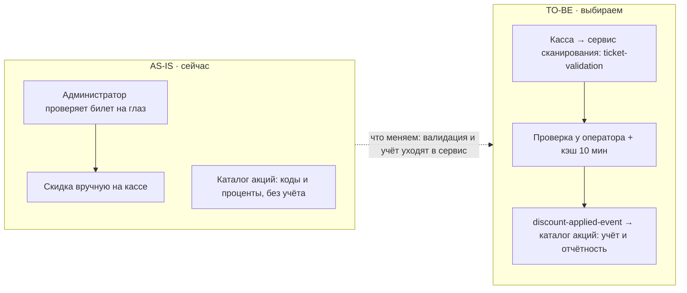

# ADR: Скидка по билету

Сравнены три варианта валидации билета на кассе; выбран V2 — синхронная валидация
через сервис сканирования с локальным кэшем результата; главная цена — консистентность
учёта «билет использован» между кассой и каталогом акций.

## Контекст

| Участник | Роль в решении |
| --- | --- |
| PO DineClub | решает приоритет фичи и лимит «одна скидка на билет» |
| Команда сервиса сканирования | владеет сервисом валидации QR — ядро V2 |
| Билетный оператор | внешний владелец API проверки билетов — только запрос-ответ |
| Команда каталога акций | владеет справочником скидок — может принимать изменения |

## AS-IS

Гость показывает билет офлайн, администратор ресторана проверяет его на глаз и
применяет скидку вручную на кассе. Сервис сканирования в проде проверяет QR для
входа на мероприятия (50 RPS), но результат проверки скидкам не отдаёт. Каталог
акций хранит коды и проценты, применений не учитывает. Учёта «билет уже использован»
для скидок нет ни в одной системе.

## Варианты

| ID | Вариант | Надёжность | Скорость реализации | Соответствие требованиям | Почему нет |
| --- | --- | --- | --- | --- | --- |
| V1 | Касса ресторана сама вызывает API билетного оператора при оплате | средняя: новый путь интеграции на каждой кассе, зависит от доступности API | средне: 3–4 недели, интеграция на стороне кассового ПО | частичное: нет учёта «использован» и событий для отчётности — лимит одной скидки не держится | нет единой точки валидации: каждая касса — свой сбойный путь, отчётность по применениям собрать нельзя |
| V2 | Сервис сканирования валидирует билет синхронно и отдаёт результат кассе, кэш результата на 10 минут | высокая: сервис уже в проде, изолирует кассы от сбоев API, деградация до кэша | быстро: 1–2 недели, переиспользуем готовый сервис | полное: валидация ≤3 с, учёт применения и событие для отчётности | выбран — обоснование в «Решении TO-BE» |
| V3 | Ночной батч: каталог акций заранее тянет список билетов у оператора и валидация идёт по локальной копии | высокая: нет онлайн-зависимости от оператора | долго: 6+ недель, новый пайплайн и расхождение копии с реальностью до суток | слабое: билет, купленный ночью, не пройдёт валидацию до следующего батча — требование «показал и получил» не выполняется | расхождение копии до суток ломает сценарий гостя на концертах |

## Решение TO-BE

| ID | Контракт | Суть решения | Обоснование |
| --- | --- | --- | --- |
| V2 | ticket-validation | Сервис сканирования при оплате синхронно проверяет билет у оператора, кэширует результат на 10 минут и отдаёт кассе вердикт + признак «использован» | единственный вариант с полной валидацией ≤3 с и без новой онлайн-зависимости касс; надёжность — сервис в проде и кэш на деградацию; скорость — 1–2 недели против 6+ у V3; требованиям — полное, включая учёт и отчётность |
| V2 | discount-applied-event | Сервис сканирования публикует событие «скидка применена», каталог акций по нему учитывает применение и закрывает суточную отчётность | событие отвязывает отчётность от кассы и каталога: применений без события не бывает; надёжность выше, чем батч V3, а реализация — переиспользование шины событий сервиса |

## Узкие места

| ID | Узкое место | Тип | Нагрузка | Риск | Прощупывание |
| --- | --- | --- | --- | --- | --- |
| N1 | Сервис сканирования на пике концерта | нагрузка | пик 300 проверок/мин против текущих 50 RPS — рост ×6 [УТОЧНИТЬ: профиль нагрузки сервисных пиков] | очередь на кассе, валидация дольше 3 с, недовольство гостей | нагрузочный тест 300 RPS до релиза + автоскейл под пиковые окна |
| N2 | API билетного оператора в час пик | надёжность | неизвестны SLA и лимиты запросов [УТОЧНИТЬ: SLA и rate limits оператора] | при недоступности API валидация падает на кассах — скидки не применяются | канарейка на одном ресторане 2 недели + метрика доли ошибок API; план деградации — кэш 10 минут |
| N3 | Консистентность учёта «использован» между кассой и каталогом | данные | две записи об одном применении при ретрае кассы | двойное применение скидки по одному билету | идемпотентность по номеру билета + репетиция ретрая на стенде |

## Компромиссы

| ID | Компромисс | Надёжность | Скорость реализации | Соответствие требованиям | Чем платим |
| --- | --- | --- | --- | --- | --- |
| C1 | Кэш результата валидации 10 минут вместо живой проверки | получили: кассы работают при сбое API до 10 минут | получили: 1–2 недели вместо 6+ | получили: валидация ≤3 с почти всегда | окно 10 минут, когда билет может быть использован дважды — контролируем учётом применений и событием |
| C2 | Учёт «использован» в сервисе сканирования, а не у оператора | получили: не зависим от внешнего API для лимита | получили: без переговоров с оператором | получили: лимит «одна скидка на билет» держится | сами отвечаем за консистентность при ретраях (N3) и миграции кэша |

## Диаграмма AS-IS/TO-BE

