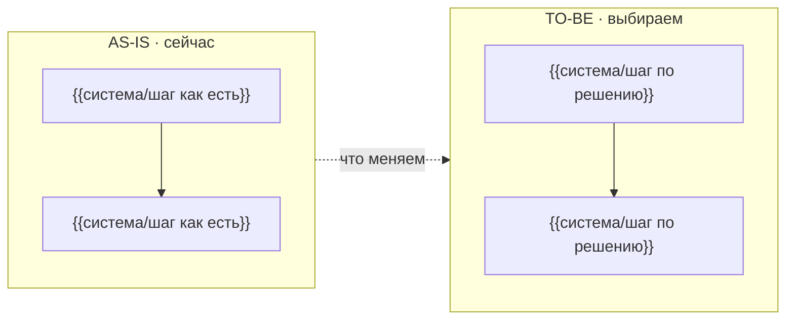

# ADR: {{название инициативы — как в «Истории»}}

<!-- bft-adr
epic_slug: {{epic_slug}}
version: 1
revised: {{YYYY-MM-DD}}
status: Черновик
-->

Этап «ADR и Системные требования», системный дизайн: как реализуем работу на карте —
контекст, ландшафт AS-IS, варианты, решение TO-BE, узкие места и компромиссы по осям
«надёжность vs скорость реализации vs соответствие требованиям». Открытые вопросы и блокеры —
в таблице «Вопросы» документа «Карта» («Где» — ID варианта или компромисса V1, C1).

## Контекст

| Участник | Роль в решении |
| --- | --- |
| {{PO / СА / команда / владелец системы — кто решает и кого касается}} | {{что именно этот участник решает или даёт}} |

## AS-IS

{{Ландшафт систем как устроен сейчас: какие системы участвуют, где живут данные, что уже есть.
Вход этапа — БФТ, «История», задачи и карточки карты (слой Technology).}}

## Варианты

| ID | Вариант | Надёжность | Скорость реализации | Соответствие требованиям | Почему нет |
| --- | --- | --- | --- | --- | --- |
| V1 | {{первый вариант реализации: как устроен, что использует}} | {{высокая/средняя/низкая + почему}} | {{быстро/средне/долго + оценка}} | {{полное/частичное/слабое + чему не отвечает}} | {{явное обоснование отклонения — или «выбран», если это TO-BE}} |
| V2 | {{второй вариант — минимум два; иначе это не выбор}} | {{…}} | {{…}} | {{…}} | {{…}} |

## Решение TO-BE

| ID | Контракт | Суть решения | Обоснование |
| --- | --- | --- | --- |
| {{V1 — ID выбранного варианта}} | {{имя контракта — попадёт в «Системные требования»}} | {{что выбираем и как это работает}} | {{почему именно этот вариант: по трём осям}} |

## Узкие места

| ID | Узкое место | Тип | Нагрузка | Риск | Прощупывание |
| --- | --- | --- | --- | --- | --- |
| N1 | {{где TO-BE просядет}} | {{нагрузка \| надёжность \| данные}} | {{оценка: RPS, объём, пики}} | {{что случится, когда просядет}} | {{как проверить до релиза: нагрузочный тест, канарейка, метрика}} |

## Компромиссы

| ID | Компромисс | Надёжность | Скорость реализации | Соответствие требованиям | Чем платим |
| --- | --- | --- | --- | --- | --- |
| C1 | {{чем платим по оси «надёжность vs скорость реализации vs соответствие требованиям»}} | {{что получили}} | {{что получили}} | {{что получили}} | {{цена: чем рискуем, что дольше}} |

## Компоненты

| ID | Компонент | Контекст | Контур | Тип | Изменение | Задачи |
| --- | --- | --- | --- | --- | --- | --- |
| M1 | {{кто пользуется: гость, официант}} | {{где он}} | — | человек | без изменений | — |
| M2 | {{компонент: экран, сервис, хранилище}} | {{система — граница C4}} | {{команда-владелец}} | {{интерфейс \| сервис \| хранилище \| очередь \| внешняя система}} | {{новый \| доработка \| без изменений}} | {{BP-5, BP-6 — где запланированы работы; нет карты — «—»}} |

## Потоки

| От | К | Данные | Способ | Контракт |
| --- | --- | --- | --- | --- |
| M1 | M2 | {{что передаётся}} | {{HTTP, синхронно \| событие, асинхронно \| интерфейс}} | {{контракт из «Решения TO-BE» или «—»}} |

## Диаграмма AS-IS/TO-BE

