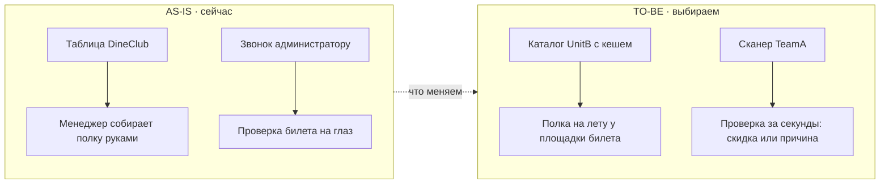

<!-- bft-adr
epic_slug: dineclub-restart
version: 1
revised: 2026-10-22
status: Предложено
-->

# ADR: Перезапуск акции DineClub — «билет Acme Tickets = скидка 10%»

Этап «ADR и Системные требования», системный дизайн: как реализуем работу на карте —
контекст, ландшафт AS-IS, варианты, решение TO-BE, узкие места и компромиссы по осям
«надёжность vs скорость реализации vs соответствие требованиям». Открытые вопросы и блокеры —
в таблице «Вопросы» документа «Карта» («Где» — ID варианта или компромисса V1, C1).

## Контекст

| Участник | Роль в решении |
| --- | --- |
| PO DineClub | Решает правила акции: размер скидки, окно 7 дней, список ресторанов |
| СА UnitB | Отвечает за каталог ресторанов и подбор у площадки билета |
| TeamA | Проверяет билеты сканером и считает компенсации ресторанам |

## AS-IS

Каталог участников акции живёт в таблице DineClub, полку ресторанов у площадки менеджер
собирает руками. Проверка билета — звонок администратору, компенсации считаются в конце
месяца вручную по выгрузке. Витрина про акцию не знает: письмо с билетом молчит про скидку.

## Варианты

| ID | Вариант | Надёжность | Скорость реализации | Соответствие требованиям | Почему нет |
| --- | --- | --- | --- | --- | --- |
| V1 | Полка ресторанов и подбор собираются на лету из каталога UnitB при открытии письма и страницы | средняя: зависимость от живого каталога при пиковой рассылке | быстро: одна интеграция, без новых сервисов | частичное: без кеша не держит пик рассылки, ФТ-3 закрывает | выбран |
| V2 | Ночная предрассчётная сборка полк в отдельном сервисе рекомендаций | высокая: свой слой данных, пик не страшен | долго: новый сервис, миграции, эксплуатация | полное | сервис не оправдан объёмом акции, к запуску не успеть |
| V3 | Подбор руками менеджера по таблице, как сейчас | высокая: ничего не ломаем | мгновенно: делать нечего | слабое: полка не собирается сама, ФТ-3 не выполняется | это AS-IS, требование не закрывает |

## Решение TO-BE

| ID | Контракт | Суть решения | Обоснование |
| --- | --- | --- | --- |
| V1 | restaurant-shelf | Полка собирается на лету из каталога UnitB по площадке активного билета: ближние × высокий рейтинг | Быстрее к запуску, пик рассылки покрывается кешем каталога, требованию ФТ-3 соответствует |
| V1 | ticket-validation | Сканер официанта проверяет билет у TeamA: валиден — скидка 10%, иначе отказ с причиной | Ответ за секунды без звонков, окно 7 дней считается на стороне TeamA |

## Узкие места

| ID | Узкое место | Тип | Нагрузка | Риск | Прощупывание |
| --- | --- | --- | --- | --- | --- |
| N1 | Живой запрос каталога при пиковой рассылке писем с билетами | нагрузка | до 400 RPS в час рассылки | задержка полки в письме, гость не видит рестораны | нагрузочный тест стенда, метрика p95 до релиза |
| N2 | Проверка билета сканером в час пик вечера пятницы | надёжность | до 60 проверок в минуту на ресторан | очередь у стола, официант не может дать скидку | канарейка на 5 ресторанах, метрика доли отказов |

## Компромиссы

| ID | Компромисс | Надёжность | Скорость реализации | Соответствие требованиям | Чем платим |
| --- | --- | --- | --- | --- | --- |
| C1 | Кеш каталога 10 минут вместо своего слоя данных | средняя | быстро | частичное | полка устаревает до 10 минут — новый ресторан появится с задержкой |
| C2 | Проверка билета синхронная, без очереди событий | средняя | быстро | частичное | при падении TeamA сканер не отвечает — риск N2 растёт |

## Диаграмма AS-IS/TO-BE

## Компоненты

| ID | Компонент | Контекст | Контур | Тип | Изменение | Задачи |
| --- | --- | --- | --- | --- | --- | --- |
| M1 | Гость | Гость Acme Tickets | — | человек | без изменений | — |
| M2 | Официант | Ресторан-участник | — | человек | без изменений | — |
| M3 | Страница после оплаты | Витрина Acme Tickets | ? | интерфейс | доработка | BP-5 |
| M4 | Раздел «Рестораны»: список и мини-полка | Витрина Acme Tickets | vit | интерфейс | доработка | BP-8, BP-11 |
| M5 | Карточка ресторана | Витрина Acme Tickets | ? | интерфейс | доработка | BP-10 |
| M6 | Каталог ресторанов | Каталог UnitB | unitb | сервис | доработка | BP-2, BP-6, BP-9 |
| M7 | Кеш каталога 10 минут | Каталог UnitB | unitb | хранилище | новый | BP-6 |
| M8 | Сервис проверки билетов | Платформа TeamA | teama | сервис | новый | BP-16 |
| M9 | Реестр использований | Платформа TeamA | teama | хранилище | новый | BP-16 |
| M10 | Триггеры касаний | Платформа TeamA | teama | сервис | новый | BP-12 |
| M11 | Email и SMS | Платформа TeamA | teama | сервис | доработка | BP-7, BP-13 |
| M12 | Приложение-сканер | Приложение DineClub | dine | интерфейс | новый | BP-15, BP-17 |
| M13 | Компенсации ресторанам | Приложение DineClub | dine | сервис | новый | BP-18 |
| M14 | Билеты Acme Tickets | Acme Tickets | ext | внешняя система | без изменений | — |

## Потоки

| От | К | Данные | Способ | Контракт |
| --- | --- | --- | --- | --- |
| M1 | M3 | Оплаченный билет: площадка и дата | интерфейс | — |
| M3 | M7 | Площадка билета → полка ресторанов | HTTP, синхронно | restaurant-shelf |
| M4 | M7 | Фильтры списка и площадка | HTTP, синхронно | restaurant-shelf |
| M7 | M6 | Промах кеша: подбор ближних × рейтинг | HTTP, синхронно | restaurant-shelf |
| M5 | M6 | Ресторан: адрес, часы работы | HTTP, синхронно | — |
| M14 | M10 | Дата мероприятия и контакты гостя | событие, асинхронно | — |
| M10 | M11 | Касание: за 24 ч и в окне 7 дней | событие, асинхронно | — |
| M11 | M1 | Письмо с билетом, напоминание, SMS | email и SMS | — |
| M1 | M2 | Показывает билет со штрихкодом | в ресторане | — |
| M2 | M12 | Сканирует штрихкод | интерфейс | — |
| M12 | M8 | Штрихкод билета → скидка или причина отказа | HTTP, синхронно | ticket-validation |
| M8 | M14 | Статус билета и дата мероприятия | HTTP, синхронно | ticket-validation |
| M8 | M9 | Отметка «использован» | запись | ticket-validation |
| M12 | M13 | Фото чека | загрузка файла | — |
| M13 | M14 | Списание по акции | событие, асинхронно | — |
