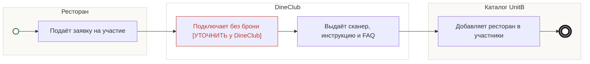

## Description

<!-- SECTION:DESCRIPTION:BEGIN -->
Ресторан подаёт заявку и подключается без брони и тяжёлой интеграции: получает доступ к сканеру, инструкцию и FAQ и попадает в каталог.

### UserStory
Как ресторан, я хочу подключиться к акции без брони и тяжёлой интеграции, чтобы начать принимать гостей по билетам.

### JobStory
- Когда я решил участвовать, хочу подключиться за пару шагов, чтобы не ждать интеграции.
- Когда я подключился, хочу сразу получить сканер и инструкцию, чтобы официанты начали работать.

### Параметры
- **Вход:** Заявка ресторана на участие
- **Управление:** Без брони и тяжёлой интеграции (ФТ-19); Скидка 10%, окно 7 дней, один билет — одна скидка; Москва и Санкт-Петербург
- **Выход:** Ресторан подключён (BP-15.1); Список ресторанов (BP-2.1); Инструкция, FAQ, контакты поддержки
- **Механизм:** DineClub; Путь подключения [УТОЧНИТЬ: борда FigJam]

### Процесс
- Ресторан: Подаёт заявку на участие
- DineClub: Подключает без брони [УТОЧНИТЬ у DineClub]
- DineClub: Выдаёт сканер, инструкцию и FAQ
- Каталог UnitB: Добавляет ресторан в участники

### BPMN

### HowToDemo
1. Ресторан подаёт заявку — подключается без брони
2. Получает доступ к приложению-сканеру, инструкцию и FAQ
3. Ресторан появляется в списке участников
<!-- SECTION:DESCRIPTION:END -->
