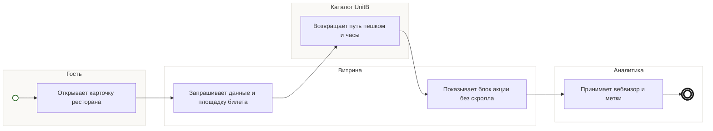

## Description

<!-- SECTION:DESCRIPTION:BEGIN -->
Карточка ресторана показывает блок акции, время пешком от площадки последнего билета и часы работы.

### UserStory
Как гость, я хочу видеть в карточке ресторана скидку, путь пешком и часы работы, чтобы решить, идти ли туда.

### JobStory
- Когда я сомневаюсь, успею ли, хочу видеть время пешком от площадки, чтобы рассчитать вечер.
- Когда ресторан мне понравился, хочу сразу видеть скидку по билету, чтобы понять выгоду.

### Параметры
- **Вход:** Открытие карточки (BP-8.1); Часы работы и площадки (BP-2.1)
- **Управление:** Блок акции виден без скролла (ИТ-4); Время пешком ±2 мин (ИТ-4); Часы работы у 100% участников (ФТ-4)
- **Выход:** Гость выбрал ресторан и ждёт мероприятия (BP-12.1); Вебвизор и метки источника (BP-19.1)
- **Механизм:** Страница ресторана; TeamA или UnitB [УТОЧНИТЬ у TeamA и UnitB]

### Процесс
- Гость: Открывает карточку ресторана
- Витрина: Запрашивает данные и площадку билета
- Каталог UnitB: Возвращает путь пешком и часы
- Витрина: Показывает блок акции без скролла
- Аналитика: Принимает вебвизор и метки

### BPMN

### HowToDemo
1. Открываю карточку ресторана из списка
2. Без скролла вижу блок акции «−10% по билету»
3. Вижу время пешком от площадки последнего билета и часы работы
4. В вебвизоре видна сессия с меткой источника
<!-- SECTION:DESCRIPTION:END -->
