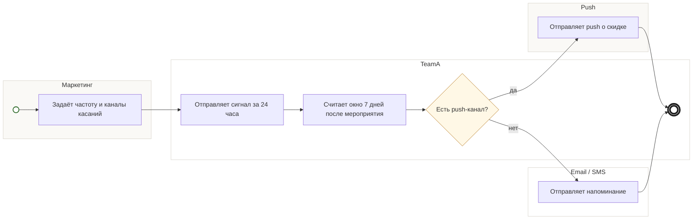

## Description

<!-- SECTION:DESCRIPTION:BEGIN -->
TeamA по дате мероприятия запускает касания: оповещение за 24 часа и напоминание в окне 7 дней — с частотой и каналами от маркетинга.

### Параметры
- **Вход:** Дата мероприятия; Частота и каналы касаний (BP-3.1)
- **Управление:** Отписки соблюдаются (ФТ-6); Касание за 24 часа (ФТ-16); Хотя бы одно касание в окне 7 дней (ФТ-6)
- **Выход:** Сигнал за 24 часа (BP-12.1); Сигнал в окне 7 дней (BP-13.1); Push, если канал есть (BP-14.1)
- **Механизм:** TeamA; Триггеры касаний

### Процесс
- Маркетинг: Задаёт частоту и каналы касаний
- TeamA: Отправляет сигнал за 24 часа
- TeamA: Считает окно 7 дней после мероприятия
- ? Есть push-канал?
  - да → Push: Отправляет push о скидке
  - нет → Email / SMS: Отправляет напоминание

### Данные
- Дата мероприятия — билет гостя
- Частота и каналы касаний — маркетинг (BP-3.1)

### BPMN

<!-- SECTION:DESCRIPTION:END -->
