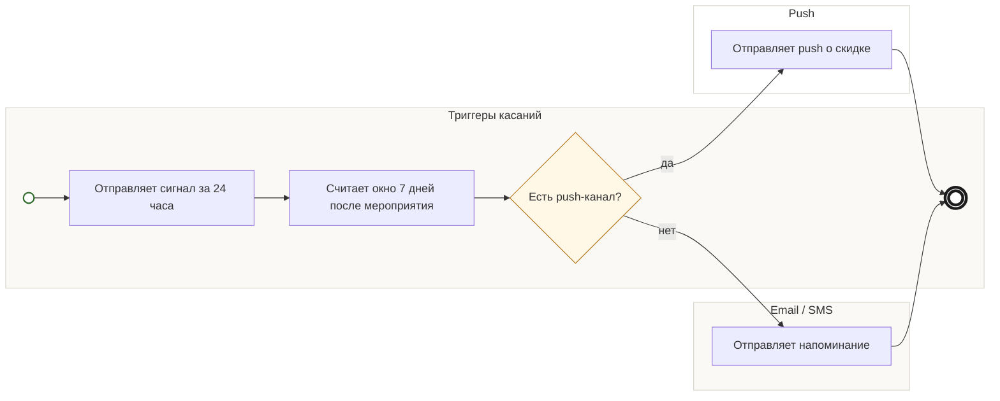

## Description

<!-- SECTION:DESCRIPTION:BEGIN -->
Триггеры касаний по дате мероприятия запускают касания: оповещение за 24 часа и напоминание в окне 7 дней — с частотой и каналами от маркетинга.

### Параметры
- **Вход:** Дата мероприятия; Частота и каналы касаний (BP-3.1)
- **Управление:** Отписки соблюдаются (ФТ-6); Касание за 24 часа (ФТ-16); Хотя бы одно касание в окне 7 дней (ФТ-6)
- **Выход:** Сигнал за 24 часа (BP-12.1); Сигнал в окне 7 дней (BP-13.1); Если есть push-канал: push о скидке (BP-14.1)
- **Механизм:** Триггеры касаний

### Процесс
- Триггеры касаний: Отправляет сигнал за 24 часа
- Триггеры касаний: Считает окно 7 дней после мероприятия
- ? Есть push-канал?
  - да → Push: Отправляет push о скидке
  - нет → Email / SMS: Отправляет напоминание

### Данные
- Дата мероприятия — билет гостя — запустить касания за 24 часа и в окне 7 дней
- Частота и каналы касаний — Триггеры касаний (BP-3.1) — выбрать канал и не превысить лимит

### BPMN

<!-- SECTION:DESCRIPTION:END -->
