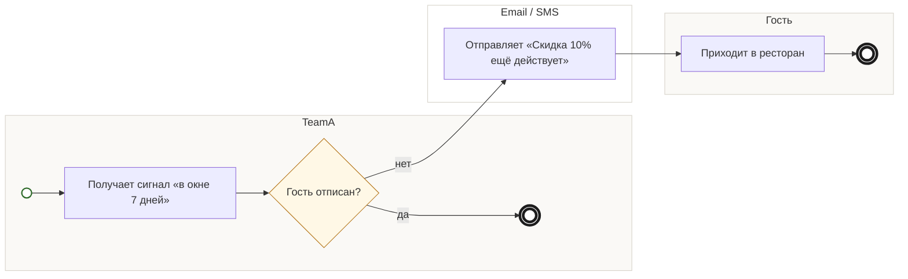

## Description

<!-- SECTION:DESCRIPTION:BEGIN -->
В окне 7 дней после мероприятия гость получает хотя бы одно напоминание письмом или SMS; отписки соблюдаются.

### UserStory
Как гость после мероприятия, я хочу получить напоминание, что скидка ещё действует, чтобы успеть ей воспользоваться.

### JobStory
- Когда мероприятие прошло, хочу знать, сколько дней осталось у скидки, чтобы выбрать вечер.

### Параметры
- **Вход:** Сигнал в окне 7 дней (BP-12.2); Мероприятие прошло (BP-12.1)
- **Управление:** Хотя бы одно касание за 7 дней (ИТ-6); Отписки соблюдаются (ФТ-6)
- **Выход:** Письмо или SMS «Скидка 10% ещё действует»; Гость пришёл в окне 7 дней (BP-15.1)
- **Механизм:** TeamA; Email и SMS

### Процесс
- TeamA: Получает сигнал «в окне 7 дней»
- ? Гость отписан?
  - нет → Email / SMS: Отправляет «Скидка 10% ещё действует»
  - да → конец
- Гость: Приходит в ресторан

### BPMN

### HowToDemo
1. Мероприятие прошло — в течение 7 дней приходит письмо или SMS «Скидка 10% ещё действует»
2. Отписываюсь — следующие напоминания не приходят
<!-- SECTION:DESCRIPTION:END -->
