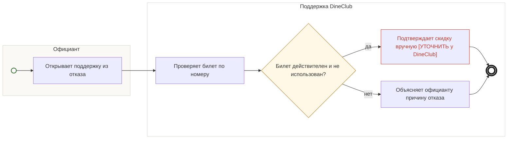

## Description

<!-- SECTION:DESCRIPTION:BEGIN -->
Сканер отказал, а гость уверен в билете: официант открывает поддержку из отказа, поддержка проверяет билет по номеру и отвечает.

### UserStory
Как официант, я хочу получить помощь, когда билет не проходит проверку, чтобы не спорить с гостем у стола.

### JobStory
- Когда сканер отказал, а гость уверен в билете, хочу быстро получить ответ поддержки, чтобы решить спор у стола.
- Когда штрихкод не читается, хочу проверить билет по номеру, чтобы гость не остался без скидки.

### Параметры
- **Вход:** Обращение из отказа сканера (BP-15.1)
- **Управление:** Одна покупка — одна скидка (ФТ-1); Ручная проверка по номеру билета [УТОЧНИТЬ у DineClub]
- **Выход:** Ответ официанту: скидка подтверждена или причина отказа
- **Механизм:** Поддержка DineClub; Инструкция и поддержка в приложении-сканере

### Процесс
- Официант: Открывает поддержку из отказа
- Поддержка DineClub: Проверяет билет по номеру
- ? Билет действителен и не использован?
  - да → Поддержка DineClub: Подтверждает скидку вручную [УТОЧНИТЬ у DineClub]
  - нет → Поддержка DineClub: Объясняет официанту причину отказа

### BPMN

### HowToDemo
1. Сканер отказал — официант открывает поддержку из отказа
2. Поддержка проверяет билет по номеру и отвечает: скидка подтверждена или причина отказа
<!-- SECTION:DESCRIPTION:END -->
