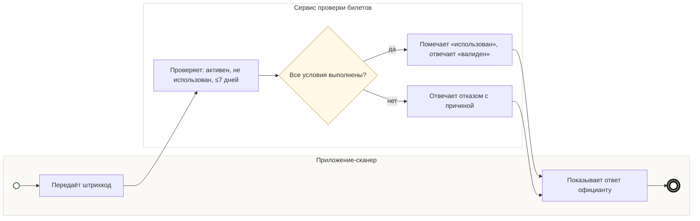

## Description

<!-- SECTION:DESCRIPTION:BEGIN -->
Сервис проверки билетов проверяет штрихкод: билет активен, не использован, мероприятие было не больше 7 дней назад. Успех помечает билет «использован», отказ возвращается с понятной причиной.

### Параметры
- **Вход:** Штрихкод на проверку (BP-15.1); Статус билета и дата мероприятия
- **Управление:** Активен, не использован, не больше 7 дней (ФТ-1); Трёхсторонний контракт DineClub, TeamA, Acme Tickets; Возврат, отмена, перенос (ФТ-15)
- **Выход:** Валиден или отказ (BP-15.1); Билет «использован» (BP-18.1)
- **Механизм:** Сервис проверки билетов

### Процесс
- Приложение-сканер: Передаёт штрихкод
- Сервис проверки билетов: Проверяет: активен, не использован, ≤7 дней
- ? Все условия выполнены?
  - да → Сервис проверки билетов: Помечает «использован», отвечает «валиден»
  - нет → Сервис проверки билетов: Отвечает отказом с причиной
- Приложение-сканер: Показывает ответ официанту

### Данные
- Штрихкод — Приложение-сканер (BP-15.1) — найти билет
- Статус билета и дата мероприятия — Acme Tickets — понять, давать ли скидку

### BPMN

<!-- SECTION:DESCRIPTION:END -->
