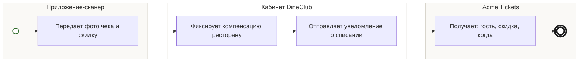

## Description

<!-- SECTION:DESCRIPTION:BEGIN -->
Фото чека попадает в кабинет DineClub: ресторану фиксируется компенсация, Acme Tickets получает уведомление о списании — гость, скидка, когда.

### Параметры
- **Вход:** Фото чека (BP-17.1); Билет «использован» (BP-16.1)
- **Управление:** Лимиты компенсаций [УТОЧНИТЬ у DineClub]; Состав уведомления: гость, скидка, когда (ФТ-14)
- **Выход:** Компенсация ресторану; Данные о списании (BP-19.1)
- **Механизм:** Кабинет DineClub; Приложение-сканер

### Процесс
- Приложение-сканер: Передаёт фото чека и скидку
- Кабинет DineClub: Фиксирует компенсацию ресторану
- Кабинет DineClub: Отправляет уведомление о списании
- Acme Tickets: Получает: гость, скидка, когда

### Данные
- Фото чека — Приложение-сканер (BP-17.1)
- Билет «использован» — Сервис проверки билетов (BP-16.1)

### BPMN

<!-- SECTION:DESCRIPTION:END -->
