## Description

<!-- SECTION:DESCRIPTION:BEGIN -->
Витрина, письма и DineClub отдают события в аналитику; воронка «билет → ресторан → скидка» собирается без ручного логирования.

### UserStory
Как PO акции, я хочу видеть воронку «билет → ресторан → скидка», чтобы понимать, где теряются гости.

### JobStory
- Когда акция запущена, хочу видеть конверсию каждого этапа, чтобы чинить слабое место.
- Когда меняется витрина, хочу видеть влияние на выбор ресторана, чтобы решать по данным.

### Параметры
- **Вход:** События блока (BP-5.1); UTM и клики (BP-7.1); Метрики фильтров (BP-8.1); Вебвизор и метки источника (BP-10.1); Данные о списании (BP-18.1)
- **Управление:** Без ручного логирования (ФТ-9); Этап выбора ресторана — детально (ФТ-9); Дашборды каталога, проверки, нагрузки (ФТ-12)
- **Выход:** Воронка «билет → ресторан → скидка»
- **Механизм:** UnitB; Яндекс.Метрика, UTM, вебвизор

### Процесс
- Витрина: Отправляет события блока и фильтров
- Email: Отправляет UTM по письмам
- DineClub: Отправляет данные о списании
- Аналитика: Собирает воронку без ручного логирования
- Acme Tickets: Видит воронку по этапам

### BPMN

```mermaid
flowchart LR
  subgraph L1["Витрина"]
    S((" "))
    N1["Отправляет события блока и фильтров"]
  end
  subgraph L2["Email"]
    N2["Отправляет UTM по письмам"]
  end
  subgraph L3["DineClub"]
    N3["Отправляет данные о списании"]
  end
  subgraph L4["Аналитика"]
    N4["Собирает воронку без ручного логирования"]
  end
  subgraph L5["Acme Tickets"]
    N5["Видит воронку по этапам"]
    E(((" ")))
  end
  S --> N1
  N1 --> N2
  N2 --> N3
  N3 --> N4
  N4 --> N5
  N5 --> E
  classDef start fill:#fff,stroke:#2f6b2a,stroke-width:2px
  classDef stop fill:#fff,stroke:#1c1c1c,stroke-width:4px
  classDef gw fill:#fff8e6,stroke:#b7791f
  classDef ask color:#c0392b,stroke:#c0392b
  class S start
  class E stop
  style L1 fill:#faf9f6,stroke:#d8d4cb
  style L2 fill:#ffffff,stroke:#d8d4cb
  style L3 fill:#faf9f6,stroke:#d8d4cb
  style L4 fill:#ffffff,stroke:#d8d4cb
  style L5 fill:#faf9f6,stroke:#d8d4cb
```

### HowToDemo
1. Прохожу путь от покупки до скидки
2. В воронке видны все этапы «билет → ресторан → скидка» без ручного логирования
3. Этап выбора ресторана разложен по фильтрам и карточкам
<!-- SECTION:DESCRIPTION:END -->
