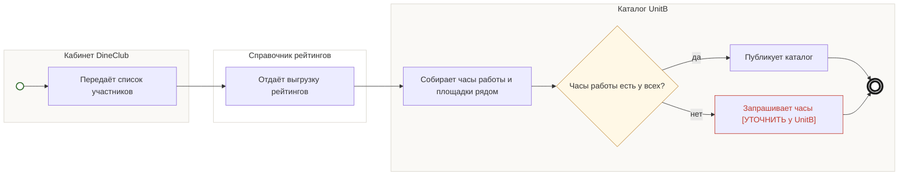

## Description

<!-- SECTION:DESCRIPTION:BEGIN -->
Каталог ресторанов собирает участников: список из кабинета DineClub, рейтинги из справочника не реже раза в квартал, часы работы и площадки рядом.

### Параметры
- **Вход:** Список ресторанов (BP-1.1); Рейтинги — выгрузка Яндекс.Карт
- **Управление:** Рейтинг — статичный справочник, не реже раза в квартал (НФТ-2); Часы работы у 100% участников (ФТ-4)
- **Выход:** Каталог участников (BP-6.1, BP-9.1, BP-11.1); Часы работы и площадки (BP-10.1)
- **Механизм:** Каталог ресторанов

### Процесс
- Кабинет DineClub: Передаёт список участников
- Справочник рейтингов: Отдаёт выгрузку рейтингов
- Каталог UnitB: Собирает часы работы и площадки рядом
- ? Часы работы есть у всех?
  - да → Каталог UnitB: Публикует каталог
  - нет → Каталог UnitB: Запрашивает часы [УТОЧНИТЬ у UnitB]

### Данные
- Список ресторанов-участников — DineClub (BP-1.1)
- Рейтинги — выгрузка Яндекс.Карт, не реже раза в квартал
- Часы работы и площадки рядом — Каталог UnitB

### BPMN

<!-- SECTION:DESCRIPTION:END -->
