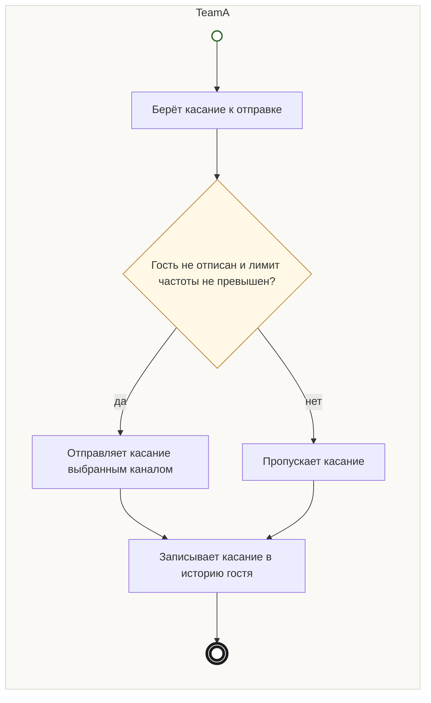

## Description

<!-- SECTION:DESCRIPTION:BEGIN -->
Перед каждым касанием акции TeamA сверяет его с правилами частоты и отписками — гость не получает лишних писем.

### UserStory
Как гость, я хочу получать напоминания о скидке не чаще оговорённого и удобным каналом, чтобы не отписываться от рассылки.

### JobStory
- Когда запускаются касания акции, хочу ограничить их частоту, чтобы гость не отписался.

### Параметры
- **Вход:** Касание к отправке
- **Управление:** Отписки соблюдаются (ФТ-6); Лимит частоты [УТОЧНИТЬ у CPO продукта]
- **Выход:** Частота и каналы касаний (BP-12.2)
- **Механизм:** TeamA; Правила касаний от маркетинга

### Процесс
- TeamA: Берёт касание к отправке
- ? Гость не отписан и лимит частоты не превышен?
  - да → TeamA: Отправляет касание выбранным каналом
  - нет → TeamA: Пропускает касание
- TeamA: Записывает касание в историю гостя

### BPMN

### HowToDemo
1. Касания в окне скидки идут по правилам частоты и каналам
2. Отписанный гость касание не получает
<!-- SECTION:DESCRIPTION:END -->
