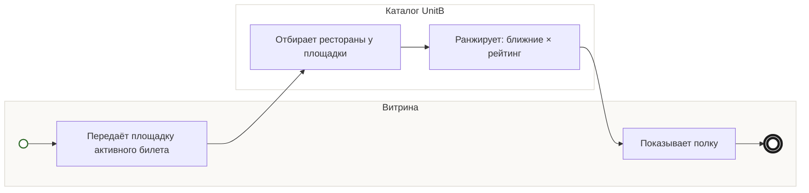

## Description

<!-- SECTION:DESCRIPTION:BEGIN -->
По площадке активного билета UnitB подбирает рестораны для полки: ближние и с высоким рейтингом.

### Параметры
- **Вход:** Каталог участников (BP-2.1); Площадка активного билета
- **Управление:** Ближние × высокий рейтинг (ФТ-3); Первыми — у площадки активного билета (ФТ-3)
- **Выход:** Рестораны у площадки (BP-5.1)
- **Механизм:** UnitB; Каталог ресторанов

### Процесс
- Витрина: Передаёт площадку активного билета
- Каталог UnitB: Отбирает рестораны у площадки
- Каталог UnitB: Ранжирует: ближние × рейтинг
- Витрина: Показывает полку

### Данные
- Каталог участников — Каталог UnitB (BP-2.1)
- Площадка активного билета — Витрина

### BPMN

<!-- SECTION:DESCRIPTION:END -->
