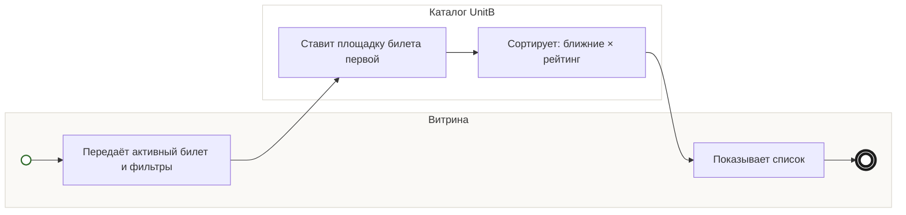

## Description

<!-- SECTION:DESCRIPTION:BEGIN -->
Для списка каталог ресторанов ставит первыми рестораны у площадки билета, дальше — по близости и рейтингу, с учётом фильтров гостя.

### Параметры
- **Вход:** Каталог участников (BP-2.1); Площадка билета; Выбранные фильтры
- **Управление:** Полный список без радиуса (ФТ-3); Ближние × высокий рейтинг (ФТ-3); Каталог выдерживает 300 ресторанов (НФТ-1)
- **Выход:** Список и данные ресторанов (BP-8.1)
- **Механизм:** Каталог ресторанов

### Процесс
- Витрина: Передаёт активный билет и фильтры
- Каталог UnitB: Ставит площадку билета первой
- Каталог UnitB: Сортирует: ближние × рейтинг
- Витрина: Показывает список

### Данные
- Каталог участников — Каталог UnitB (BP-2.1)
- Площадка билета и фильтры гостя — Витрина

### BPMN

<!-- SECTION:DESCRIPTION:END -->
