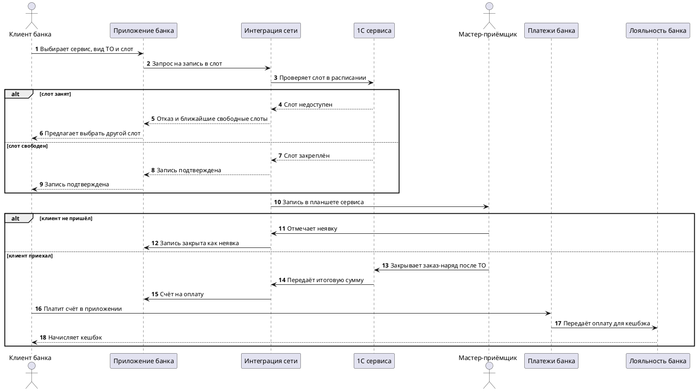

# [БФТ] car-service-booking: Запись на ТО автомобиля через партнёрское мобильное приложение банка

## Шапка (сутевое описание запроса)

### Цель

| SMART | Значение |
|---|---|
| S (Specific) | Клиент банка в мобильном приложении банка выбирает автосервис сети «АвтоЛайн» и слот на ТО; сеть подтверждает слот из своей учётной системы (1С); мастер-приёмщик видит запись в планшете; после ТО клиент получает счёт и платит в приложении, банк начисляет кешбэк |
| M (Measurable) | Инварианты записи I1–I4 соблюдаются; каждый параметр P1–P6 исполняется системой или закрыт решением бизнеса; разрывы G1–G3 закрыты или перенесены с владельцем |
| A (Achievable) | Приложение банка, платёжный шлюз банка и программа кешбэка уже есть; новое — запись на ТО, обмен «банк ↔ сеть ↔ 1С» и счёт после ТО |
| R (Relevant) | Сейчас запись идёт по телефону и через сайт сети, оплата — на кассе сервиса; клиенты банка не получают кешбэк за услуги автосервиса |
| T (Time-bound) | [УТОЧНИТЬ у Дарьи Мельниковой] — срок запуска пилота в первых сервисах сети не назван |

### How to demo

1. Клиент банка открывает в приложении раздел «Автосервис», выбирает сервис сети, вид ТО и свободный слот → запись создана в статусе «Ожидает подтверждения».
2. Сеть автосервисов проверяет слот в 1С сервиса и подтверждает его → клиент видит запись «Подтверждена».
3. Мастер-приёмщик открывает в планшете сервиса запись клиента и отмечает приём автомобиля → ТО начато.
4. Мастер-приёмщик закрывает заказ-наряд в 1С → клиент получает в приложении счёт на оплату.
5. Клиент платит счёт в приложении → банк начисляет кешбэк по правилам программы, клиент видит его в приложении.

### Ограничения и договоренности

* Вне зоны документа: ремонт вне планового ТО, продажа запчастей, запись на шиномонтаж, личный кабинет сети автосервисов вне приложения банка
* Целевая модель — запись и оплата внутри приложения банка; слот и заказ-наряд ведутся в 1С сервиса, банк не хранит расписание сервиса
* Размеры кешбэка и штрафов в примерах обезличены; рабочие значения — только из подписанного договора банка и сети

### Общая информация

| Поле | Значение |
| --- | --- |
| Название проекта | Запись на ТО через приложение банка |
| Ответственный за продукт | Дарья Мельникова |
| Ответственный за документ | Игорь Ставров |
| Задача/Epic Jira | [СОЗДАТЬ эпик] |
| Статус | АНАЛИЗ |

## Проблема которую решаем

| Срез | Содержание |
| --- | --- |
| Кто страдает | Клиент банка, мастер-приёмщик сервиса, команда лояльности банка |
| Что болит | Запись на ТО — звонок или сайт сети; слот в расписании 1С и в телефонной записи расходятся; оплата на кассе не даёт клиенту кешбэка банка |
| Цена проблемы | Часть слотов теряется из-за двойных записей и неявок без предупреждения; банк не получает выручку от услуг автосервиса внутри приложения [УТОЧНИТЬ у Дарьи Мельниковой] объём потерь на встрече не называли |

## Изменение в UJM

| Точка демо | Было (As-Is) | Стало (To-Be) |
| --- | --- | --- |
| Запись на ТО | Звонок в сервис или заявка на сайте сети, слот подтверждает оператор | Клиент выбирает сервис и слот в приложении банка, слот подтверждает сеть из 1С |
| Приём автомобиля | Мастер-приёмщик ищет запись в журнале или по телефону клиента | Запись видна мастеру в планшете, приём отмечается в одно действие |
| Оплата и кешбэк | Оплата на кассе сервиса, кешбэк банка не начисляется | Счёт приходит в приложение, клиент платит там же, банк начисляет кешбэк |

## План демонстрации

### Акторы

| Актор | Описание |
| --- | --- |
| Клиент банка | Выбирает сервис и слот, отменяет или переносит запись, получает счёт и платит в приложении |
| Мастер-приёмщик | Видит записи в планшете сервиса, отмечает приём или неявку, закрывает заказ-наряд |
| Менеджер лояльности банка | Настраивает правила кешбэка за услуги автосервиса и разбирает спорные начисления |
| Сеть автосервисов | Внешняя система: подтверждает слоты, ведёт справочник сервисов и услуг, выставляет счёт |
| Учётная система сервиса (1С) | Внешняя система: расписание постов, заказ-наряды и закрытие работ |

### Сценарий приёмки (happy path + alt)

| What-if | Ответ |
| --- | --- |
| Слот заняли, пока клиент выбирал | Сеть отклоняет запись, приложение показывает ближайшие свободные слоты (ФТ-2) |
| Клиент отменяет запись | Слот освобождается в 1С, клиент видит запись «Отменена»; условия отмены без штрафа [УТОЧНИТЬ у Дарьи Мельниковой] срок и размер штрафа |
| Клиент не пришёл | Мастер отмечает неявку, слот закрывается, счёт не выставляется (ФТ-4) |
| Сеть не ответила на запрос подтверждения | Запись остаётся «Ожидает подтверждения», клиенту уходит уведомление; автоотмена по таймауту [УТОЧНИТЬ у Игоря Ставрова] |
| Оплата прошла, кешбэк не начислился | Начисление повторяется по идемпотентному ключу платежа, спорный случай — менеджеру лояльности (ФТ-8) |
| Итоговая сумма в 1С изменилась после выставления счёта | Новый счёт не выставляется, поправка — отдельный счёт после отмены прежнего (ФТ-7) |

## Бизнес-Требования

## Ценность разрабатываемого функционала для бизнес-заказчиков*

| Идентификатор | Наименование требования | Ценность разрабатываемого функционала для бизнес-заказчиков | Краткое описание доработки из данного БФТ | Критерий приёмки | Связанные требования |
| --- | --- | --- | --- | --- | --- |
| БТ-1 | Запись на ТО без звонка | Клиент банка записывается в приложении, сервис получает подтверждённую запись без оператора | Выбор сервиса и слота в приложении, подтверждение сетью из 1С | Запись из приложения появляется в планшете мастера с подтверждённым слотом | ПТ-1, ФТ-1, ФТ-2, ФТ-3 |
| БТ-2 | Оплата ТО в приложении банка | Выручка от услуг автосервиса проходит через банк, клиент платит без кассы | Счёт после ТО в приложении и оплата через платёжную команду банка | Оплаченный счёт совпадает с заказ-нарядом 1С по сумме | ФТ-6, ФТ-7, ФТ-8 |
| БТ-3 | Кешбэк как мотивация записи | Клиент получает кешбэк банка за ТО, оплаченное в приложении | Начисление кешбэка по правилам программы после оплаты счёта | Кешбэк начислен один раз на оплаченный счёт | ПТ-C1, ФТ-8, ФТ-9 |

## Пользовательские требования*

| Идентификатор | Наименование требования | Story | Комментарий | Критерий приёмки | Связанные требования |
| --- | --- | --- | --- | --- | --- |
| ПТ-1 | Запись на ТО в приложении | **Когда** мне нужно ТО автомобиля, **я хочу** выбрать сервис сети и свободный слот в приложении банка, **чтобы** не звонить в сервис | Детальные шаги — в ролях ПТ-А1…ПТ-А4 | Клиент проходит путь от выбора сервиса до подтверждённой записи только в приложении | БТ-1, ФТ-1, ИТ-1 |

### Пользовательские требования по ролям

| Роль | Пользовательские требования | Экраны | Примечание |
| --- | --- | --- | --- |
| A. Клиент банка | ПТ-А1…ПТ-А4 | ИТ-1, ИТ-3 | Запись, отмена, оплата |
| B. Мастер-приёмщик | ПТ-B1, ПТ-B2 | ИТ-2 | Работа в планшете сервиса |
| C. Менеджер лояльности банка | ПТ-C1, ПТ-C2 | ИТ-4 | Правила и споры по кешбэку |

**Роль A. Клиент банка** — запись, отмена, оплата:

| Идентификатор | Наименование требования | Story | Комментарий | Критерий приёмки | Связанные требования |
| --- | --- | --- | --- | --- | --- |
| ПТ-А1 | Выбор сервиса и слота | **Когда** я решил записаться на ТО, **я хочу** выбрать сервис сети, вид ТО и свободный слот, **чтобы** не согласовывать время по телефону | Автомобиль выбирается из сохранённых в профиле клиента | Недоступные слоты не предлагаются к выбору | ФТ-1, ФТ-2 |
| ПТ-А2 | Статус записи | **Когда** я отправил запись, **я хочу** видеть, подтверждена ли она сервисом, **чтобы** знать, ехать ли мне | Статусы: ожидает подтверждения, подтверждена, отменена, неявка, выполнена | Статус записи в приложении совпадает со статусом в сети | ФТ-3, ФТ-5 |
| ПТ-А3 | Отмена и перенос | **Когда** мои планы изменились, **я хочу** отменить запись или перенести её на другой слот, **чтобы** не блокировать время сервиса | Условия отмены без штрафа — параметр P3 | После отмены слот снова доступен другим клиентам | ФТ-5 |
| ПТ-А4 | Счёт и оплата | **Когда** сервис закрыл ТО, **я хочу** получить счёт и оплатить его в приложении, **чтобы** не платить на кассе и получить кешбэк | Сумма счёта берётся из заказ-наряда 1С | Оплата счёта в приложении переводит запись в «Выполнена» | ФТ-6, ФТ-7, ФТ-8 |

**Роль B. Мастер-приёмщик** — приём автомобиля:

| Идентификатор | Наименование требования | Story | Комментарий | Критерий приёмки | Связанные требования |
| --- | --- | --- | --- | --- | --- |
| ПТ-B1 | Записи дня в планшете | **Когда** начинается смена, **я хочу** видеть в планшете подтверждённые записи на день, **чтобы** подготовить посты и не искать клиента в журнале | Показываются записи только своего сервиса | Подтверждённая запись видна в планшете сразу после подтверждения | ФТ-3, ФТ-4 |
| ПТ-B2 | Приём или неявка | **Когда** клиент приехал или не приехал, **я хочу** отметить приём или неявку одним действием, **чтобы** слот не висел и заказ-наряд открылся в 1С | Неявка фиксируется после окончания слота | Отметка приёма открывает заказ-наряд, неявка закрывает слот | ФТ-4, ФТ-6 |

**Роль C. Менеджер лояльности банка** — кешбэк:

| Идентификатор | Наименование требования | Story | Комментарий | Критерий приёмки | Связанные требования |
| --- | --- | --- | --- | --- | --- |
| ПТ-C1 | Правила кешбэка за ТО | **Когда** запускается программа с сетью, **я хочу** задать правила кешбэка за услуги автосервиса, **чтобы** клиент получал его без ручных начислений | Размер и потолок — параметр P5 | Правило применяется к оплатам после даты начала действия | ФТ-9, НФТ-3 |
| ПТ-C2 | Разбор спорного начисления | **Когда** клиент пишет, что кешбэк не пришёл, **я хочу** увидеть по оплате, начислен ли кешбэк и по какому правилу, **чтобы** ответить без обращения в разработку | Поиск — по номеру счёта или оплаты | По оплате видны правило, сумма и статус начисления | ФТ-8, ФТ-9 |

## Требования к интерфейсам*

| Идентификатор | Наименование требования | Требование к пользовательскому интерфейсу | Предложения по элементам UI, механике и композиции | Критерий приёмки | Связанные требования |
| --- | --- | --- | --- | --- | --- |
| ИТ-1 | Экран «Запись на ТО» в приложении | Список сервисов сети, выбор вида ТО, календарь свободных слотов, статус записи, отмена и перенос | Недоступные слоты скрыты; при отказе по занятому слоту показаны ближайшие свободные | Выбор слота и отправка записи возможны без выхода из экрана | ПТ-1, ПТ-А1, ПТ-А2, ПТ-А3 |
| ИТ-2 | Экран «Записи дня» в планшете сервиса | Список записей на день со статусом, действия «Принят» и «Неявка» | `[УТОЧНИТЬ]` — макета планшета нет | Действие приёмщика отражается в статусе записи без перезагрузки | ПТ-B1, ПТ-B2 |
| ИТ-3 | Экран «Счёт на оплату» в приложении | Состав работ из заказ-наряда, итоговая сумма, кнопка оплаты, кешбэк за оплату | Кешбэк показывается до подтверждения оплаты как ожидаемый | После оплаты экран показывает статус «Оплачено» и начисленный кешбэк | ПТ-А4 |
| ИТ-4 | Экран «Начисления кешбэка за ТО» для менеджера лояльности | Правила кешбэка с датами действия, список начислений по оплатам, статус и причина отказа | `[УТОЧНИТЬ]` — макета нет | По оплате видны правило и статус начисления | ПТ-C1, ПТ-C2 |

## Макеты интерфейса*

`[УТОЧНИТЬ у Игоря Ставрова — макетов экранов ИТ-1…ИТ-4 нет]`.

## Функциональные требования*

| Идентификатор | Наименование требования | Приоритет | Функциональные требования | Параметры, ограничения | Критерий приёмки | Связанные требования |
| --- | --- | --- | --- | --- | --- | --- |
| ФТ-1 | Справочник сервисов и услуг сети | Высокий | Приложение показывает сервисы сети и виды ТО из справочника сети; банк не хранит собственную копию расписания | Справочник приходит от сети по запросу приложения | Приложение показывает только сервисы и услуги, отданные сетью | БТ-1, ПТ-1, ПТ-А1 |
| ФТ-2 | Проверка и закрепление слота | Высокий | Сеть проверяет слот в 1С сервиса и закрепляет его за записью; занятый слот отклоняется с перечнем ближайших свободных | Закрепление идемпотентно по номеру записи банка | Один слот не закрепляется за двумя записями; занятый слот не принимается | БТ-1, ПТ-А1 |
| ФТ-3 | Подтверждение записи сетью | Высокий | Сеть возвращает банку подтверждение или отказ; запись до ответа в статусе «Ожидает подтверждения» | Таймаут ожидания подтверждения P2 | Статус записи в приложении совпадает со статусом в сети | БТ-1, ПТ-А2, ПТ-B1 |
| ФТ-4 | Запись в планшете мастера и отметка приёма | Высокий | Подтверждённая запись передаётся в планшет сервиса; мастер отмечает приём или неявку, отметка передаётся в 1С и в банк | Неявка допустима только после окончания слота | Приём открывает заказ-наряд в 1С; неявка закрывает слот и запись | БТ-1, ПТ-B1, ПТ-B2 |
| ФТ-5 | Отмена и перенос записи | Высокий | Клиент отменяет или переносит запись; слот освобождается в 1С; условия отмены без штрафа берутся из параметра P3 | Перенос — отмена прежнего слота и закрепление нового как одна операция | Отменённый слот доступен для новой записи; перенос не оставляет два слота | ПТ-А2, ПТ-А3 |
| ФТ-6 | Закрытие заказ-наряда и передача суммы | Высокий | После закрытия заказ-наряда в 1С сеть передаёт банку состав работ и итоговую сумму | Одна запись — один заказ-наряд | Сумма в банке равна сумме заказ-наряда 1С | БТ-2, ПТ-А4, ПТ-B2 |
| ФТ-7 | Счёт на оплату в приложении | Высокий | Банк выставляет клиенту счёт по данным заказ-наряда; повторная передача суммы не создаёт второй счёт | Счёт действует до оплаты или отмены | Один заказ-наряд — не больше одного действующего счёта | БТ-2, ПТ-А4 |
| ФТ-8 | Оплата и возврат статуса в сеть | Высокий | Платёжная команда банка принимает оплату счёта, переводит запись в «Выполнена» и сообщает сети об оплате | Оплата идемпотентна по номеру счёта | Оплаченный счёт отражается в сети и в 1С; повторная оплата не списывает второй раз | БТ-2, БТ-3, ПТ-А4, ПТ-C2 |
| ФТ-9 | Начисление кешбэка | Средний | Команда лояльности начисляет кешбэк по правилам P5 на оплаченный счёт один раз | Начисление идемпотентно по номеру оплаты; отмена оплаты отзывает кешбэк | Один оплаченный счёт — одно начисление по действующему правилу | БТ-3, ПТ-C1, ПТ-C2 |

**Параметры записи (к ФТ-3, ФТ-5, ФТ-9, ПТ-А3, ПТ-C1)** — реестр P1–P6; ● — обязателен, ○ — по договору сети, – — не применяется:

| Параметр | Запись и слот | Отмена и неявка | Оплата и кешбэк |
| --- | --- | --- | --- |
| P1 длительность слота по виду ТО | ● | – | – |
| P2 таймаут подтверждения сетью | ● | – | – |
| P3 срок отмены без штрафа | – | ● | – |
| P4 штраф за неявку | – | ○ | – |
| P5 размер и потолок кешбэка | – | – | ● |
| P6 срок действия счёта | – | – | ○ |

**Инварианты записи** — нарушение любого блокирует выставление счёта:

| ID | Инвариант |
| --- | --- |
| I1 | Один слот закреплён не больше чем за одной активной записью |
| I2 | Счёт выставляется только по закрытому заказ-наряду 1С, и сумма счёта равна сумме заказ-наряда |
| I3 | Одна оплата — одно начисление кешбэка |
| I4 | Статус записи в приложении не расходится со статусом в сети после завершения обмена |

**Разрывы с текущим процессом**:

| ID | Разрыв | Статус |
| --- | --- | --- |
| G1 | Часть сервисов сети ведёт расписание в 1С не по постам, а по мастерам | Открыт — [УТОЧНИТЬ у Игоря Ставрова] как сеть приводит расписание к единому виду для приложения |
| G2 | Сервисы без планшетов принимают клиентов по бумажному журналу | Открыт — приём в таких сервисах не описан |
| G3 | Штраф за неявку сейчас не взимается | Решено: на пилоте штраф не применяется, P4 не заполняется |

## Нефункциональные требования*

| Идентификатор | Наименование требования | Описание | Критерий приёмки | Связанные требования |
| --- | --- | --- | --- | --- |
| НФТ-1 | Скорость подтверждения слота | Сеть отвечает банку на запрос записи не дольше 5 секунд, иначе запись остаётся в ожидании | 95% запросов — до 5 секунд | ФТ-2, ФТ-3 |
| НФТ-2 | Защита данных клиента | Сеть и сервис получают только имя, телефон и автомобиль клиента; платёжные данные остаются в банке | В сообщениях в сеть нет платёжных реквизитов | ФТ-4, ФТ-8 |
| НФТ-3 | Сроки начисления кешбэка | Кешбэк начисляется в течение суток после оплаты счёта | 100% начислений — не позже суток от оплаты | ФТ-9 |

## Зависимости

| Команда / система | Тип зависимости | Статус согласования |
| --- | --- | --- |
| Команда мобильного приложения банка (Анна Рогова) | Экраны записи, статуса и счёта в приложении | Согласовано |
| Платёжная команда банка (Сергей Ильин) | Выставление счёта, приём оплаты, возвраты | Согласовано |
| Команда интеграций сети автосервисов (Игорь Ставров) | API банка с сетью, справочник, подтверждение слотов, планшет сервиса | Ожидает оценки |
| Учётная система сервисов (1С, внешняя) | Расписание постов, заказ-наряды, закрытие работ | Внешняя зависимость |
| Команда лояльности банка (Марина Кузнецова) | Правила и начисление кешбэка | Ожидает оценки |

## Риски

| Риск | Вероятность | Влияние | Митигация |
| --- | --- | --- | --- |
| Версии 1С в сервисах сети различаются, обмен слотами работает не везде | Средняя | Высокое | Пилот в сервисах с единой версией 1С, остальные — по готовности (G1) |

## Якоря истины

| Утверждение | Источник |
| --- | --- |
| Подтверждение слота сетью — до 5 секунд | Встреча с командой интеграций сети |
| Кешбэк начисляется в течение суток после оплаты | Договорённости с командой лояльности |
| Расписание и заказ-наряды ведутся в 1С сервиса | Встреча с командой интеграций сети |
