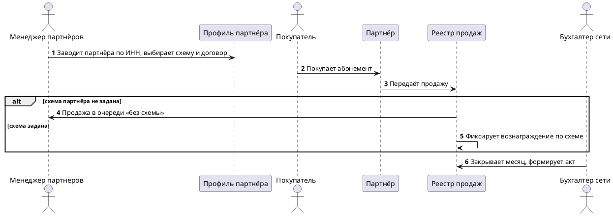

# [БФТ] club-partners: Продажа абонементов сети клубов через партнёров по трём схемам расчётов

## Шапка (сутевое описание запроса)

### Цель

| SMART | Значение |
|---|---|
| S (Specific) | Партнёры (агрегаторы, корпоративные порталы, банки) продают абонементы сети клубов «Пульс» по одной из трёх схем расчётов: агентская, комиссионная, перепродажа; условия договора партнёра исполняются системой без ручных таблиц |
| M (Measurable) | Все инварианты расчётов I1–I4 соблюдаются; каждый параметр договора P1–P8 исполняется системой или закрыт решением бизнеса; разрывы G1–G3 закрыты или перенесены с владельцем |
| A (Achievable) | Каталог абонементов и платёжный модуль уже есть; новое — реестр договоров и правила расчётов |
| R (Relevant) | Сейчас расчёты с 40 партнёрами ведёт бухгалтерия в таблицах: акты задерживаются на 10 дней, ошибки в вознаграждении — 3–5 в месяц |
| T (Time-bound) | [УТОЧНИТЬ у Марины Лесковой] — срок запуска первой схемы не назван |

### How to demo

1. Менеджер партнёров заводит партнёра по ИНН, выбирает схему расчётов и прикрепляет договор → профиль партнёра активен.
2. Модератор каталога открывает партнёру тарифы абонементов → партнёр видит их в своей витрине.
3. Покупатель покупает абонемент у партнёра → продажа попадает в реестр с вознаграждением по схеме партнёра.
4. Покупатель возвращает абонемент → возврат удерживается по шкале возвратов договора.
5. Бухгалтер закрывает месяц → акт и отчёт партнёру сформированы, суммы сходятся с реестром продаж.

### Ограничения и договоренности

* Вне зоны документа: интеграция с учётной системой бухгалтерии (отдельный трек), мобильное приложение клубов
* Целевая модель — расчёты по договору партнёра в системе продаж, без отдельной расчётной программы
* Цифры вознаграждений в примерах обезличены; рабочие значения — только из подписанных договоров

### Общая информация

| Поле | Значение |
| --- | --- |
| Название проекта | Партнёрские продажи абонементов |
| Ответственный за продукт | Марина Лескова |
| Ответственный за документ | Олег Ветров |
| Задача/Epic Jira | [СОЗДАТЬ эпик] |
| Статус | АНАЛИЗ |

## Проблема которую решаем

| Срез | Содержание |
| --- | --- |
| Кто страдает | Бухгалтер сети и менеджер партнёров |
| Что болит | Условия 40 договоров живут в таблицах; вознаграждение и возвраты считаются руками |
| Цена проблемы | Акты партнёрам — с задержкой 10 дней; 3–5 ошибок в вознаграждении в месяц |

## Изменение в UJM

| Точка демо | Было (As-Is) | Стало (To-Be) |
| --- | --- | --- |
| Подключение партнёра | Договор — PDF в почте, условия переносятся в таблицу | Профиль партнёра со схемой и договором в системе |
| Продажа | Вознаграждение считается в конце месяца | Вознаграждение фиксируется в момент продажи по схеме партнёра |
| Закрытие месяца | Бухгалтер сводит таблицы 10 дней | Акт и отчёт формируются из реестра продаж |

## План демонстрации

### Акторы

| Актор | Описание |
| --- | --- |
| Менеджер партнёров | Заводит партнёров и договоры, выбирает схему расчётов |
| Модератор каталога | Открывает партнёрам тарифы абонементов |
| Бухгалтер сети | Закрывает месяц: акты, отчёты, сверка с партнёром |
| Покупатель | Покупает и возвращает абонемент у партнёра |
| Партнёр | Внешняя система продаж: агрегатор, портал, банк |

### Сценарий приёмки (happy path + alt)

| What-if | Ответ |
| --- | --- |
| Партнёр передал продажу дважды | Реестр принимает одну продажу на номер чека партнёра; повтор — в журнал (ФТ-3) |
| Возврат после закрытия месяца | Возврат уходит в следующий отчётный период (ФТ-4) |
| У партнёра закончился договор | Новые продажи не принимаются, менеджер получает уведомление [УТОЧНИТЬ у Марины Лесковой] каким каналом |

## Бизнес-Требования

## Ценность разрабатываемого функционала для бизнес-заказчиков*

| Идентификатор | Наименование требования | Ценность разрабатываемого функционала для бизнес-заказчиков | Краткое описание доработки из данного БФТ | Критерий приёмки | Связанные требования |
| --- | --- | --- | --- | --- | --- |
| БТ-1 | Расчёты с партнёрами без ручных таблиц | Акты партнёрам — в день закрытия месяца вместо 10 дней | Реестр договоров и правила расчётов по трём схемам | Акт за месяц формируется из реестра продаж без ручного свода | ПТ-1, ФТ-1, ФТ-2, ФТ-5 |
| БТ-2 | Вознаграждение без ошибок | Ноль ошибок в вознаграждении против 3–5 в месяц | Вознаграждение фиксируется в момент продажи по параметрам договора | Вознаграждение в реестре совпадает с расчётом по договору на контрольной выборке | ФТ-2, ФТ-3, ФТ-4 |

## Пользовательские требования*

| Идентификатор | Наименование требования | Story | Комментарий | Критерий приёмки | Связанные требования |
| --- | --- | --- | --- | --- | --- |
| ПТ-1 | Схема расчётов партнёра | **Когда** бизнес подключает партнёра, **я хочу** чтобы система предлагала одну из трёх схем с её параметрами, **чтобы** условия договора исполнялись без таблиц | Параметры схемы — реестр P1–P8 | Для каждой схемы в профиле видны её параметры из матрицы | БТ-1, ФТ-1, ИТ-1 |

### Пользовательские требования по ролям

| Роль | Пользовательские требования | Экраны | Примечание |
| --- | --- | --- | --- |
| A. Менеджер партнёров | ПТ-А1…ПТ-А3 | ИТ-1 | Договор — в профиле партнёра |
| B. Бухгалтер сети | ПТ-B1, ПТ-B2 | ИТ-3 | Закрытие месяца |
| C. Модератор каталога | ПТ-C1, ПТ-C2 | ИТ-2 | Доступ к тарифам |

**Роль A. Менеджер партнёров** — партнёры и договоры:

| Идентификатор | Наименование требования | Story | Комментарий | Критерий приёмки | Связанные требования |
| --- | --- | --- | --- | --- | --- |
| ПТ-А1 | Партнёр по ИНН | **Когда** я договорился с новым партнёром, **я хочу** найти или создать его по ИНН, **чтобы** не заводить дубли | Дубль по ИНН не создаётся | Повторный ИНН открывает существующий профиль | ФТ-1 |
| ПТ-А2 | Договор в профиле | **Когда** договор подписан, **я хочу** прикрепить его к профилю с датами действия, **чтобы** продажи шли только по действующему договору | Даты начала и окончания обязательны | Без договора профиль не становится активным | ФТ-1, ФТ-6 |
| ПТ-А3 | Схема и параметры договора | **Когда** я прикрепил договор, **я хочу** выбрать схему и заполнить параметры P1–P8 по матрице, **чтобы** система считала вознаграждение сама | Параметры, не нужные схеме, скрыты | Нельзя сохранить профиль с пустым обязательным параметром схемы | ФТ-2, ПТ-1 |

**Роль B. Бухгалтер сети** — закрытие месяца:

| Идентификатор | Наименование требования | Story | Комментарий | Критерий приёмки | Связанные требования |
| --- | --- | --- | --- | --- | --- |
| ПТ-B1 | Закрытие месяца | **Когда** месяц закончился, **я хочу** сформировать акты всем партнёрам одной операцией, **чтобы** не сводить таблицы | Акт — по отчётному периоду договора (P5) | Акты всех активных партнёров сформированы за одну операцию | ФТ-5 |
| ПТ-B2 | Сверка с партнёром | **Когда** партнёр прислал свой отчёт, **я хочу** увидеть расхождения с реестром по каждой продаже, **чтобы** закрыть спор до подписания акта | Сверка по номеру чека партнёра | Расхождение показано построчно с суммой | ФТ-3, ФТ-5 |

**Роль C. Модератор каталога** — доступ к тарифам:

| Идентификатор | Наименование требования | Story | Комментарий | Критерий приёмки | Связанные требования |
| --- | --- | --- | --- | --- | --- |
| ПТ-C1 | Тарифы для партнёра | **Когда** партнёр активен, **я хочу** открыть ему нужные тарифы абонементов, **чтобы** он продавал только согласованное | Эксклюзивные тарифы — по P7 | Партнёр видит в витрине только открытые ему тарифы | ФТ-6, НФТ-2 |
| ПТ-C2 | Снятие тарифа | **Когда** тариф выводится из продажи, **я хочу** снять его у всех партнёров сразу, **чтобы** не продавать неактуальное | Уже проданные абонементы действуют | Снятый тариф пропадает из витрин партнёров | ФТ-6 |

## Требования к интерфейсам*

| Идентификатор | Наименование требования | Требование к пользовательскому интерфейсу | Предложения по элементам UI, механике и композиции | Критерий приёмки | Связанные требования |
| --- | --- | --- | --- | --- | --- |
| ИТ-1 | Экран «Профиль партнёра» | Реквизиты по ИНН, договор с датами, схема расчётов и её параметры, статус профиля | Параметры схемы — блок, который меняется от выбранной схемы | Смена схемы меняет набор параметров без перезагрузки | ПТ-1, ПТ-А1, ПТ-А2, ПТ-А3 |
| ИТ-2 | Экран «Тарифы партнёра» | Список тарифов с отметкой «открыт партнёру», массовое снятие тарифа | `[УТОЧНИТЬ]` — макета нет | Отметка и снятие видны в списке сразу после сохранения | ПТ-C1, ПТ-C2 |
| ИТ-3 | Экран «Закрытие месяца» | Список партнёров периода, статус акта, расхождения сверки | Расхождения — раскрываемая строка партнёра | По каждому партнёру видно: акт сформирован или есть расхождения | ПТ-B1, ПТ-B2 |

## Макеты интерфейса*

`[УТОЧНИТЬ у Олега Ветрова — макетов экранов ИТ-1…ИТ-3 нет]`.

## Функциональные требования*

| Идентификатор | Наименование требования | Приоритет | Функциональные требования | Параметры, ограничения | Критерий приёмки | Связанные требования |
| --- | --- | --- | --- | --- | --- | --- |
| ФТ-1 | Профиль партнёра и реестр договоров | Высокий | Система хранит партнёра по ИНН, договор с датами действия и схему расчётов; без действующего договора профиль не активен | Один партнёр — один действующий договор на период | Профиль без договора не принимает продажи | БТ-1, ПТ-А1, ПТ-А2 |
| ФТ-2 | Вознаграждение по схеме | Высокий | В момент продажи система фиксирует вознаграждение партнёра по схеме и параметрам договора: P1 процент, P2 сбор покупателя, P6 НДС | Агентская: от цены; комиссионная: от цены за вычетом сбора; перепродажа: разница цен | Вознаграждение каждой продажи в реестре равно расчёту по матрице схем | БТ-2, ПТ-А3 |
| ФТ-3 | Приём продаж от партнёра | Высокий | Реестр принимает продажу от партнёра один раз на номер чека; повтор пишется в журнал и не меняет суммы | Продажа без схемы — в очередь «без схемы» менеджеру | Повторная передача чека не создаёт вторую продажу | БТ-2, ПТ-B2 |
| ФТ-4 | Возвраты по шкале договора | Высокий | Возврат удерживается по шкале возвратов P4; возврат после закрытия периода — в следующий период | Шкала — проценты удержания по дням до начала абонемента | Удержание по возврату равно шкале договора; поздний возврат — в следующем периоде | БТ-2 |
| ФТ-5 | Акты и отчёты партнёрам | Высокий | Акт и отчёт партнёру формируются из реестра продаж по отчётному периоду P5 | Формат отчёта партнёра [УТОЧНИТЬ у Олега Ветрова] | Суммы акта равны сумме продаж и возвратов реестра за период | БТ-1, ПТ-B1, ПТ-B2 |
| ФТ-6 | Доступ партнёра к тарифам | Средний | Партнёр продаёт только открытые ему тарифы; эксклюзив P7 закрывает тариф другим партнёрам | Снятие тарифа не отменяет проданные абонементы | Продажа закрытого тарифа отклоняется | ПТ-А2, ПТ-C1, ПТ-C2 |

**Параметры договора по схемам (к ФТ-2, ПТ-1, ИТ-1)** — реестр P1–P8; ● — обязателен, ○ — по договору, – — не применяется:

| Параметр | Агентская | Комиссионная | Перепродажа |
| --- | --- | --- | --- |
| P1 процент вознаграждения | ● | ● | – |
| P2 сбор покупателя | ○ | ● | – |
| P3 цена закупки | – | – | ● |
| P4 шкала возвратов | ● | ● | ○ |
| P5 отчётный период | ● | ● | ● |
| P6 НДС | ○ | ○ | ● |
| P7 эксклюзив тарифа | ○ | ○ | ○ |
| P8 лимит продаж в месяц | – | ○ | ● |

**Инварианты расчётов** — нарушение любого блокирует закрытие месяца:

| ID | Инвариант |
| --- | --- |
| I1 | Сумма вознаграждений периода равна сумме по продажам минус удержания по возвратам |
| I2 | Каждая продажа принадлежит ровно одному договору |
| I3 | Возврат не больше исходной продажи |
| I4 | Акт периода не меняется после подписания; поправки — в следующем периоде |

**Разрывы с текущим процессом**:

| ID | Разрыв | Статус |
| --- | --- | --- |
| G1 | Лимит продаж P8 сейчас контролируется вручную по телефону | Открыт — [УТОЧНИТЬ у Марины Лесковой] нужна ли блокировка продаж сверх лимита |
| G2 | Партнёры-банки передают продажи раз в сутки пакетом | Открыт — пакетная передача не описана |
| G3 | Старые договоры без шкалы возвратов | Решено: шкала по умолчанию из типового договора |

## Нефункциональные требования*

| Идентификатор | Наименование требования | Описание | Критерий приёмки | Связанные требования |
| --- | --- | --- | --- | --- |
| НФТ-1 | Скорость приёма продаж | Продажа от партнёра фиксируется в реестре не дольше 5 секунд | 95% продаж — до 5 секунд | ФТ-3 |
| НФТ-2 | Разграничение доступа | Модератор не видит параметров договора; менеджер не формирует акты | Попытка чужого действия отклоняется | ПТ-C1, ФТ-5 |
| НФТ-3 | Журнал изменений договора | Каждое изменение параметров договора пишется с автором и временем | По профилю видна история изменений | ФТ-1, ФТ-2 |

## Зависимости

| Команда / система | Тип зависимости | Статус согласования |
| --- | --- | --- |
| Команда продаж (Ирина Зотова) | Реестр продаж, приём продаж от партнёров | Согласовано |
| Команда каталога (Павел Дронов) | Тарифы и доступ партнёров | Согласовано |
| Команда финансов (Олег Ветров) | Акты, отчёты, закрытие месяца | Ожидает оценки |
| Партнёры (внешние системы) | Передача продаж и возвратов | Внешняя зависимость |

## Риски

| Риск | Вероятность | Влияние | Митигация |
| --- | --- | --- | --- |
| Партнёры-банки не перейдут на передачу каждой продажи | Средняя | Высокое | Пакетная передача — отдельное решение (G2) |

## Якоря истины

| Утверждение | Источник |
| --- | --- |
| 40 партнёров, акты с задержкой 10 дней | Встреча с бухгалтерией 10.09 |
| Три схемы расчётов | Договорная политика сети |
